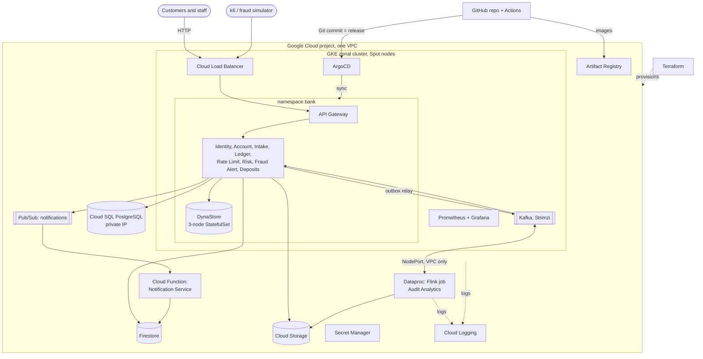
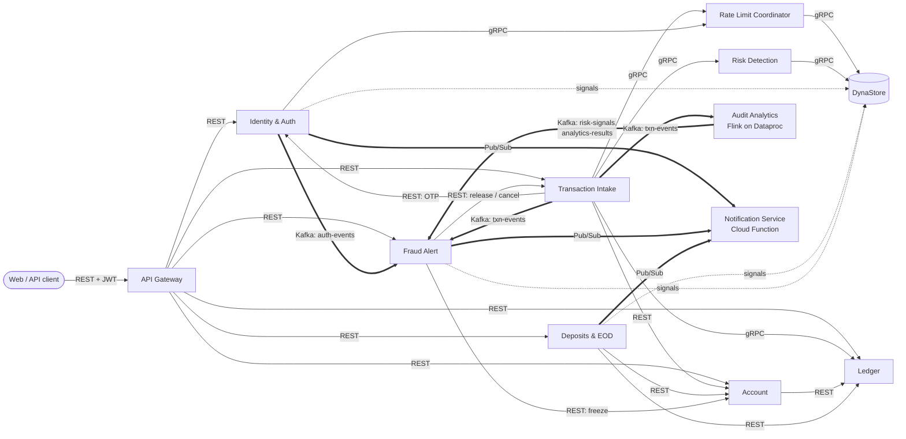

# Unbeatable Bank: Design Document

CS/SS G527 Cloud Computing. Scenario: **Banking Transaction Monitoring** (transaction
admission and fraud monitoring). Concept: **leaderless replication / Dynamo-like storage**.

## 1. System overview

Unbeatable Bank is a small but complete retail bank: customers sign up, open savings,
current, fixed-deposit and recurring-deposit accounts (alone or jointly), pay each
other by account number or scan-to-pay alias, and earn interest. Every payment is
admitted through several layers of defence before money moves, and everything that
happens is streamed to analytics and to the fraud team.

Two properties drive the design:

1. **Money must never be created, lost or moved twice.** This needs strong
   consistency, so balances and the ledger live in PostgreSQL behind one service.
2. **Admission control must always answer, fast, even while parts are failing.**
   Rate-limit counters and fraud features are written on every request, tolerate
   being slightly stale, and must survive node failures. This is exactly what
   Dynamo-style leaderless replication is for, so they live in **DynaStore**, the
   store we built for the course concept.

Keeping those two kinds of data apart, and saying why, is the central design decision.

### The five layers of defence for a payment

| Layer | When | Service | Technique |
|---|---|---|---|
| 1. Admission | before anything else | Rate Limit Coordinator | sliding-window limits per customer, account, device and IP, on CRDT counters in DynaStore |
| 2. Authorisation and policy | synchronous | Account, Transaction Intake | holder check, account status, per-payment / new-payee / daily limits |
| 3. Real-time risk | synchronous, tens of ms | Risk Detection | weighted rules over DynaStore features: ALLOW, CHALLENGE (OTP), HOLD (analyst), BLOCK |
| 4. Stream analytics | seconds to minutes | Audit Analytics (Flink) | windowed aggregations that see patterns no single payment shows (mule fan-in, bursts, structuring) |
| 5. Response | minutes | Fraud Alert | alerts, automatic freezes, cases, maker-checker review; signals fed back into layer 3 |

## 2. Requirement coverage

| Req. | How it is met | Where |
|---|---|---|
| 8+ microservices, one public | 12 services; the API Gateway is public behind a load balancer | `services/`, `functions/` |
| (a) IaC | Terraform, three layers: bootstrap (project, IAM, state, budgets), main (network, GKE, Cloud SQL, Firestore, GCS, Pub/Sub, function, Dataproc, IAM, secrets), platform (in-cluster secrets, ArgoCD) | `infra/` |
| (b) Serverless | Notification Service is a Cloud Function (2nd gen), triggered asynchronously by Pub/Sub | `functions/notification`, `infra/main/function.tf` |
| (b) REST, gRPC, queues | REST: client to gateway, gateway to services, service to service. gRPC: Intake to Ledger, Rate Limit, Risk; all DynaStore traffic. Queues: Kafka (events), Pub/Sub (notifications) | `proto/`, section 5 |
| (c) Managed K8s + HPA | GKE; HPAs on gateway, intake and risk (CPU 60%); k6 load test | `deploy/bank`, `loadtest/payments.js` |
| (d) GitOps | ArgoCD app-of-apps tracks this repository; releases are Git commits made by CI | `deploy/argocd`, `.github/workflows/release.yml` |
| (e) Flink on managed cluster | Flink SQL job on Dataproc: Kafka `txn-events` in, tumbling/hopping windows, results to `analytics-results` and `risk-signals` | `services/audit-analytics`, `infra/main/dataproc.tf` |
| (f) Concept | DynaStore: consistent hashing, N/R/W quorums, vector clocks, CRDT counters, sloppy quorum, hinted handoff, read repair, anti-entropy | `services/dynastore`, section 6 |
| (g) Three storage products | Cloud SQL (PostgreSQL), Firestore, Cloud Storage (plus DynaStore itself) | section 7 |
| (h) Observability | Prometheus + Grafana dashboard (RPS, errors, latency, cluster health, HPA, domain metrics); centralised logs in Cloud Logging for GKE and the Dataproc job | `deploy/monitoring`, section 9 |

## 3. Cloud deployment architecture

Notes on the deployment:

- **One zonal GKE cluster with Spot nodes.** A zonal cluster has no management fee and
  Spot VMs cost about a third. A reclaimed node is tolerated: services are stateless,
  DynaStore is leaderless, Kafka and DynaStore keep their disks.
- **Cloud SQL has only a private IP**; nothing outside the VPC can reach the ledger.
  Each service has its own database user and schema.
- **Kafka runs in the cluster** (Strimzi operator, KRaft). The Flink job on Dataproc is
  in the same VPC and reaches it through a NodePort that the firewall only opens to
  the VPC's own ranges.
- **Workload Identity** gives the three services that call Google APIs an identity
  without key files. GitHub Actions authenticates with Workload Identity Federation.
- **Cost control** is part of the design: `make down` scales nodes to zero, stops
  Cloud SQL and deletes Dataproc; budgets alert at 30/60/80% of each $50 credit.

## 4. Microservices

### Responsibilities

| # | Service | Responsibility | Runs on | Data |
|---|---|---|---|---|
| 1 | **API Gateway** | Only public entry point. Verifies the JWT, checks role and account ownership, forwards with an `X-Actor` header, serves the web app | GKE, HPA | none |
| 2 | **Identity & Auth** | Sign-up, login, JWT, devices, sessions, OTP, staff logins; detects new-device logins and impossible travel | GKE | Cloud SQL, Firestore |
| 3 | **Account** | Customers (one record per person), accounts of every product type, joint holders, limits, freeze, payees with cooling period, scan-to-pay aliases, hash-chained audit log | GKE | Cloud SQL |
| 4 | **Transaction Intake** | Accepts payments and runs the admission pipeline (section 1). Idempotency, limits, OTP challenge, holds | GKE, HPA | Cloud SQL |
| 5 | **Rate Limit Coordinator** | Shared rate-limit state and permit allocation for all pods; policies from a ConfigMap | GKE | DynaStore |
| 6 | **Ledger** | The only code that moves money. Double-entry journals, balances, holds, reversals, interest, reconciliation | GKE | Cloud SQL |
| 7 | **Risk Detection** | Scores each payment against 17 weighted rules using DynaStore features; shadow mode for new rules | GKE, HPA | DynaStore |
| 8 | **Fraud Alert** | Consumes events and Flink signals; alerts, automatic freezes, cases, analyst workflow with maker-checker; customer inbox API | GKE | Cloud SQL, Firestore |
| 9 | **Notification Service** | Writes the customer inbox, simulated SMS for OTPs, optional email | **Cloud Function** | Firestore |
| 10 | **Audit Analytics** | Windowed aggregation of the transaction stream: throughput, rejections, rate-limit decisions, unique customers, fraud patterns | **Flink on Dataproc** | Kafka, GCS checkpoints |
| 11 | **Deposits & EOD** | Fixed and recurring deposits, rate cards, early closure, the end-of-day batch (interest, installments, maturities), bank calendar | GKE | Cloud SQL, GCS |
| 12 | **DynaStore** | The leaderless key-value store (the course concept) | GKE StatefulSet | local disk |

The eight services suggested for the scenario are numbers 3 to 10. Gateway, Identity,
Deposits and DynaStore were added to make it a working bank.

## 5. Interconnection mechanisms

| Mechanism | Used for | Why |
|---|---|---|
| **REST** (JSON over HTTP) | Client to gateway; gateway to services; service-to-service calls that are not on the hot path | Universal, easy to inspect, fine for request/response at human speed |
| **gRPC** (HTTP/2, protobuf) | Intake to Rate Limit, Risk and Ledger; every DynaStore call | These calls happen on every payment. Binary framing, typed contracts in `proto/`, deadlines and status codes. Clients balance across pods through headless Services so autoscaled pods receive traffic |
| **Kafka** | `txn-events`, `auth-events`, `risk-signals`, `analytics-results`, ledger and account events | Durable, replayable, ordered per key. Decouples the payment path from analytics and fraud response; it is what Flink reads and writes |
| **Pub/Sub** | `notifications` topic to the Cloud Function | Native trigger for the serverless function, with retries |

**Transactional outbox.** A service never writes to Kafka directly. It inserts the
event into an `outbox` table in the same database transaction as the business
change; a relay sidecar publishes it afterwards. An event therefore exists if and
only if the change committed. Delivery is at-least-once and consumers are idempotent.

**Trust boundary.** Only the gateway is reachable from outside. It discards any
incoming `X-Actor` header, verifies the token and sets `X-Actor` itself. A
NetworkPolicy stops anything outside the namespace from reaching internal services.

## 6. The concept: leaderless replication in DynaStore

DynaStore is our own implementation of the ideas in Amazon's Dynamo paper, written
in Python with gRPC between nodes. It runs as a 3-node StatefulSet.

| Technique | Implementation |
|---|---|
| Partitioning | Consistent hashing ring with virtual nodes; a key's preference list is the first N distinct nodes clockwise |
| Replication | N = 3. Any node coordinates any request. There is no leader and no election |
| Tunable consistency | Per request: W acknowledgements for a write, R answers for a read (default R = W = 2) |
| Versioning | Registers carry vector clocks; concurrent writes are kept as siblings |
| Conflict-free counters | PN-counter CRDT: each node increments only its own slot, merge takes the per-slot maximum, so concurrent increments are never lost |
| Sloppy quorum + hinted handoff | If a replica is down the write goes to the next healthy node, which keeps a hint and hands the data over when the replica returns |
| Read repair | A read that finds replicas disagreeing writes the merged value back |
| Anti-entropy | A background task compares digests with peers and exchanges differences |
| Failure detection | Heartbeats between peers |
| Expiry | TTL per key; window counters clean themselves up |
| Fault injection | An admin endpoint can take a node "down" or block peers, to demonstrate all of the above |

### How the bank uses it

| Keyspace | Writer | Consistency | Why leaderless fits |
|---|---|---|---|
| Rate-limit window counters | Rate Limit Coordinator | W = 1, R = 1 | Written on every request; must never block admission; a small over-count during a partition is acceptable |
| Risk features: velocity counters, usual amount, first-seen device/payee | Risk Detection | W = 1, R = 1 | Same: high write rate, stale by milliseconds is harmless |
| Cross-service fraud signals with TTL (new-device login, impossible travel, early FD closure, Flink pattern hits) | Identity, Deposits, Fraud Alert | W = 1 | Best-effort hints that expire on their own |
| Deny list: accounts that received confirmed fraud | Fraud Alert | W = 1 | Read on every payment; an entry that arrives a moment late on one replica is repaired by the next read |

### Where it is deliberately not used

Balances are **not** in DynaStore. With leaderless replication two coordinators can
both accept a debit and reconcile afterwards; for a counter that is correct, for a
bank balance it is a double spend (the Dynamo paper's shopping cart has the same
anomaly, where it is tolerable). Money therefore lives in PostgreSQL:

- a debit is one transaction that locks the balance rows in a fixed order, checks
  funds, writes both ledger entries and the outbox event;
- every journal has a unique idempotency key, so a retried request cannot post twice;
- database constraints refuse an unbalanced journal, an overdrawn balance or an edit
  to history even if application code is wrong.

### Degraded behaviour

When DynaStore cannot be reached at all, the system degrades by amount instead of
failing: small payments are still admitted (fail open), large ones are refused by
the rate limiter or held by the risk engine (fail closed).

## 7. Storage

| Product | What is stored | Why this product |
|---|---|---|
| **Cloud SQL for PostgreSQL** | Customers, accounts, ledger, payments, deposits, credentials, cases | Relational data that needs ACID transactions and constraints. Databases: `core_banking` (schemas `ledger`, `account`, `intake`, `deposits`), `identity`, `cases` |
| **Firestore** | Sessions, login events, fraud alerts, notification inbox, analytics snapshots | Semi-structured, write-heavy, read by key or by one field; no joins needed |
| **Cloud Storage** | End-of-day reports, Flink job files and checkpoints, function source, Terraform state | Objects |
| **DynaStore** | Rate-limit counters, risk features, signals | See section 6 |

Schema changes are Alembic migrations in each service; ArgoCD runs them as a PreSync
Job before rolling out new pods, so the database follows Git like everything else.

## 8. Stream processing

The Audit Analytics job is three SQL files submitted to Flink on Dataproc. It reads
`txn-events` with event-time watermarks and keeps windowed state, checkpointed to
Cloud Storage.

| Window | Output | Topic |
|---|---|---|
| 1 min tumbling | events, completed, declined, held, challenged, rate-limited, risk-blocked, **unique customers**, completed amount | `analytics-results` |
| 1 min tumbling per account | burst of attempts | `risk-signals` |
| 5 min hopping per account | micro-payment probing | `risk-signals` |
| 1 h hopping per account | structuring just under Rs 50,000 | `risk-signals` |
| 10 min hopping per receiving account | mule fan-in: sizeable payments from many senders | `risk-signals` |

Fraud Alert turns `risk-signals` into alerts and cases, and writes a short-lived
signal into DynaStore so the real-time risk engine scores the next payment from
that account higher. The slow, wide view feeds the fast, narrow one.

The same SQL runs in CI on a local Flink mini-cluster with file-backed tables.

## 9. Scalability, resilience and observability

- **Autoscaling.** HPAs on gateway, intake and risk scale on 60% CPU between 1 and
  4-6 replicas. Services are stateless; shared state is in DynaStore, PostgreSQL or
  Kafka, so any replica can serve any request.
- **Health.** `/healthz` (liveness) never touches a dependency; `/readyz`
  (readiness) does, so a database outage takes pods out of rotation instead of
  restart-looping them.
- **Retries are safe everywhere.** Idempotency keys at the gateway API, in Intake,
  in the Ledger, in deposits and in the end-of-day batch.
- **Metrics.** Every service exposes Prometheus metrics for request rate, error rate
  and latency (HTTP and gRPC) plus domain counters: payment decisions, rate-limit
  decisions, risk rule hits, DynaStore quorum latency, hinted handoffs, read repairs.
  One Grafana dashboard shows these with HPA replicas and node/pod health.
- **Logs.** Services log JSON to stdout. GKE ships container logs to Cloud Logging,
  and Dataproc ships the Flink job's logs there too, so one place holds the logs of
  every microservice including the analytics job.

## 10. Security

- Passwords are stored as salted scrypt hashes, OTPs as hashes, PAN only as a keyed hash.
- Short-lived JWTs; new devices are detected and scored; OTP step-up for risky payments.
- Role-based staff access (ADMIN, ANALYST, TELLER, KYC); unfreezing an account needs
  a second member of staff (maker-checker).
- Account history is an append-only hash chain; tampering is detectable.
- Secrets are generated by Terraform, kept in Secret Manager, and never committed.
- Least privilege: one database user per service, Workload Identity only where needed,
  non-root containers, NetworkPolicy around internal services.

## 11. Design rationale in brief

| Decision | Alternative | Why |
|---|---|---|
| Ledger in PostgreSQL, counters in DynaStore | Everything in one store | Each kind of data gets the consistency it needs (section 6) |
| One Ledger service owns all balance changes | Each service updates balances | One place to get locking, idempotency and double entry right |
| Transactional outbox | Publish to Kafka inside the request | No lost or phantom events when a pod dies between commit and publish |
| gRPC to headless Services with client-side balancing | gRPC through a ClusterIP | Long-lived HTTP/2 connections would pin all traffic to one pod and defeat the HPA |
| Flink SQL | Hand-written Flink Java/Python job | Windowing logic is declarative, reviewable and testable locally |
| Kafka in-cluster (Strimzi) | Managed Kafka | Cost: the managed service alone would exceed the project budget |
| Cloud Logging for logs | Loki/EFK in the cluster | Covers Dataproc as well, nothing to operate, free at this volume |
| Rendered manifests in Git (Kustomize) | Helm chart with templates | A pull request shows the exact Kubernetes change; CI validates every manifest |
| Rules and limits in ConfigMaps from Git | Admin UI writing to a database | Changes are reviewed, versioned and rolled back like code |

## 12. Known limitations

- Single region and zone; one Kafka broker; Cloud SQL without high availability or
  backups. All are cost choices for a student project and are one Terraform variable
  or manifest change away from the production setting.
- DynaStore's membership is static (the peers are listed in configuration). Adding
  nodes means a rolling restart; anti-entropy then moves the data.
- SMS is simulated (real SMS in India needs DLT registration); email is optional.
- The service-to-service trust model relies on network isolation rather than mTLS.
